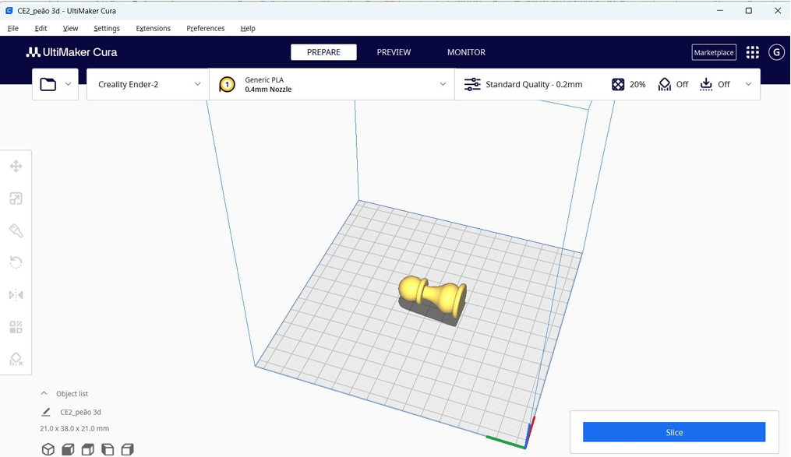

# 3.2 Layout do UltiMaker Cura e Preparação da Peça

Ao abrir o **UltiMaker Cura**, você verá uma tela limpa dividida em 5 áreas principais:

### Mapa da Interface
1. **Abas Superiores (`PREPARE` | `PREVIEW` | `MONITOR`):**
   * **PREPARE:** Onde você importa o `.STL`, posiciona, gira, escala a peça e ajusta os parâmetros.
   * **PREVIEW:** A aba mais importante antes de salvar! Mostra a simulação exata de cada camada, os suportes gerados e os movimentos de deslocamento.
2. **Barra de Configuração (Topo):**
   * **Esquerda:** Seleção da impressora (ex.: `Creality Ender-2`).
   * **Centro:** Material e **diâmetro do bico** (`0.4mm Nozzle` ou `0.8mm Nozzle`) — **SEMPRE confira o bico antes de fatiar!**
   * **Direita:** Painel de configurações de impressão (*Print Settings*). Clique em **Custom** para acessar todos os ajustes detalhados.
3. **Barra de Ferramentas Lateral Esquerda (Manipulação da Peça):**
   * **Move (T):** Mover a peça na mesa (X, Y, Z).
   * **Scale (S):** Alterar tamanho em milímetros ou porcentagem.
   * **Rotate (R):** Girar a peça. Dica: use o botão **"Select face to align to the build plate"** para clicar na face plana da peça que deve ficar encostada na mesa!
   * **Mirror (M):** Espelhar a peça (útil para fazer lados esquerdo/direito).
   * **Support Blocker (E):** Bloquear suportes em regiões específicas onde eles não são necessários.
4. **Área Central (Mesa Virtual):** Representa o volume útil exato da impressora. Se a peça ficar **listrada de cinza/amarelo**, significa que ela está fora dos limites da mesa ou grande demais.
5. **Botão Azul `Slice` (Canto Inferior Direito):** Executa o fatiamento, exibe o **tempo estimado** e o **peso em gramas de filamento**, e libera o botão **Save to Disk** (salvar `.gcode`).

> **Regra de ouro no `PREVIEW`:** Nunca salve um arquivo `.gcode` sem clicar em **PREVIEW** e arrastar a barra lateral de camadas de baixo para cima. Verifique se a **camada 1** está totalmente apoiada na mesa (sem partes flutuando no ar)!

---

[⬅️ 3.1 Fatiadores e o UltiMaker Cura](3.1-fatiadores-e-ultimaker-cura.md) | [🏠 Início](../README.md) | [Próximo: 3.3 Qualidade, Paredes e Infill ➡️](3.3-qualidade-paredes-infill.md)
