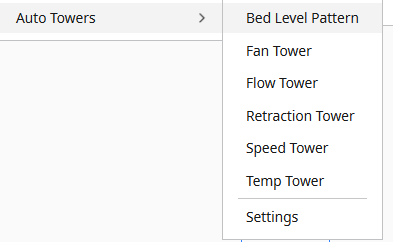

# 3.6 Torres de Calibração (*Auto Towers*) no UltiMaker Cura

Antes de imprimir um projeto demorado ou quando você troca para um rolo novo de filamento (por exemplo, ao passar de PLA para PETG), como saber a temperatura exata ou a retração perfeita sem ficar no "achismo"?

A resposta está nas **Torres de Calibração** — modelos de teste padronizados que alteram automaticamente um parâmetro a cada andar impresso, permitindo enxergar na prática o comportamento do plástico naquela máquina específica.

## Como Instalar o Plugin *Auto Towers* no Cura
1. No canto superior direito do UltiMaker Cura, clique em **Marketplace**.
2. Pesquise por **AutoTowers Generator** e clique em **Install**.
3. Reinicie o Cura.
4. Acesse no menu superior: **Extensions > Auto Towers**.

## Para que serve cada teste do menu *Auto Towers*

| Teste / Torre | O que Avalia na Prática | Quando Utilizar no LabIFMaker |
| :--- | :--- | :--- |
| **Bed Level Pattern** *(Padrão de Nivelamento)* | Imprime quadrados/linhas finas nos 4 cantos e no centro da mesa. | Logo após nivelar a mesa manualmente (Ender-2 Pro e Wanhao i3) para confirmar se a primeira camada está uniforme. |
| **Temp Tower** *(Torre de Temperatura)* | Varia a temperatura do bico a cada andar (ex.: de 220 °C a 190 °C no PLA, ou 250 °C a 220 °C no PETG). | **Primeiro teste obrigatório** ao usar um filamento novo. Revela qual temperatura entrega melhor acabamento, menos fios e pontes mais limpas. |
| **Retraction Tower** *(Torre de Retração)* | Varia a distância de retração entre duas torres separadas. | Essencial para eliminar *stringing* ("teias de aranha"), especialmente ao calibrar **PETG**. |
| **Flow Tower** *(Torre de Fluxo)* | Testa diferentes porcentagens de fluxo de extrusão (ex.: 90% a 110%). | Quando peças com encaixes ficam ligeiramente apertadas demais (excesso de material) ou com falhas entre linhas (subextrusão). |
| **Speed Tower** *(Torre de Velocidade)* | Aumenta a velocidade de impressão progressivamente nos andares superiores. | Para descobrir até qual velocidade a máquina imprime sem gerar vibrações nas quinas ou perda de qualidade. |
| **Fan Tower** *(Torre de Ventoinha)* | Varia a porcentagem de refrigeração da peça a cada nível. | Útil para encontrar o ponto ideal de ventilação do **PETG** (equilíbrio entre bom acabamento e adesão entre camadas). |

> **Uso Pedagógico no LabIFMaker:** Na prática do laboratório, essas torres funcionam como uma demonstração visual direta antes das produções finais — você analisa os andares impressos, escolhe o melhor desempenho e registra esses valores como *set point* definitivo no seu perfil do Cura.

---

[⬅️ 3.5 Refrigeração, Suportes e Aderência](3.5-refrigeracao-suportes-aderencia.md) | [🏠 Início](../README.md) | [Próximo: 3.7 Teste seus Conhecimentos ➡️](3.7-teste-seus-conhecimentos.md)
