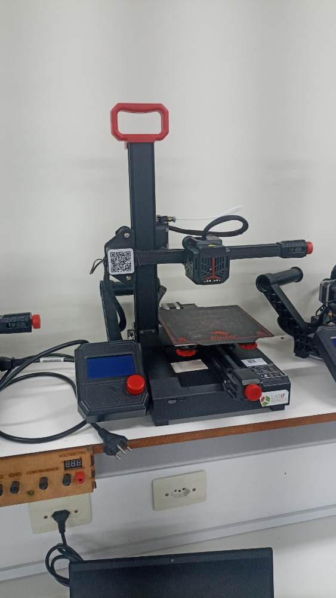
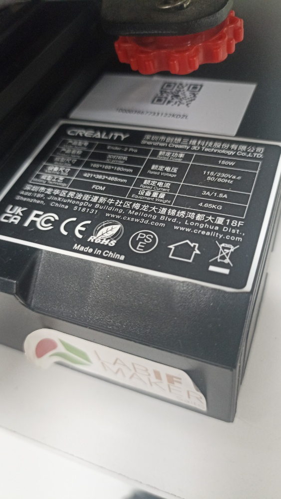

# 4.2 Guia Prático: Creality Ender-2 Pro

A **Creality Ender-2 Pro** é uma impressora compacta, silenciosa e excelente para iniciantes imprimirem peças pequenas e médias em **PLA** e **PETG**.

## Especificações Técnicas (Etiqueta do Equipamento)
* **Volume de impressão:** `165 × 165 × 180 mm`
* **Sistema de extrusão:** *Bowden* (tubo PTFE) — **Retração: 5,0 mm**
* **Bico padrão:** `0,4 mm`
* **Mesa:** Magnética flexível com aquecimento
* **Transferência de arquivo:** Cartão **microSD**

## Configuração no UltiMaker Cura
1. Vá em **Settings > Printer > Add Printer > Add a non-networked printer**.
2. Em **Creality3D**, selecione **Creality Ender-2 Pro** (ou **Creality Ender-2** ajustando X=165, Y=165, Z=180 mm).
3. Confira se o bico está em **0.4 mm Nozzle** e a retração em **5,0 mm** (40 mm/s).

## Passo a Passo na Bancada (Do Zero até a Peça Pronta)

1. **Verifique a chave de tensão** na fonte (padrão do laboratório) e ligue o interruptor lateral.
2. **Limpe a manta magnética:** passe um papel toalha com álcool isopropílico (com a mesa fria) para remover gordura dos dedos.
3. **Pré-aqueça a máquina:** gire o botão vermelho (encoder) no visor e acesse **Prepare > Preheat PLA** (ou ajuste manualmente em *Control > Temperature* para PETG: 235 °C / 75 °C).
4. **Carregue o filamento:** com o bico quente, aperte a alavanca da extrusora (atrás do eixo X), insira o filamento cortado a 45° pelo tubo branco até encostar no bico e sair um fio contínuo e limpo.
5. **Nivelamento manual com folha A4 (se necessário):**
   * Acesse **Prepare > Auto Home** e depois **Prepare > Disable Steppers** (para soltar os motores).
   * Mova o bico manualmente para os 4 cantos sobre as **roldanas vermelhas** embaixo da mesa.
   * Passe uma folha sulfite A4 entre o bico e a mesa: você deve sentir um **leve atrito** (a folha raspa de leve, mas desliza sem amassar). Gire as roldanas para subir ou descer a mesa até igualar os 4 cantos e o centro.
6. **Inicie a impressão:** insira o microSD com o `.gcode`, acesse **Print from TF**, escolha seu arquivo e **acompanhe os primeiros 5 minutos** para garantir que a 1ª camada aderiu perfeitamente.
7. **Retirada segura:** aguarde a mesa esfriar para abaixo de **35 °C**, retire a manta magnética flexível e **curve-a suavemente** — a peça se solta sozinha sem precisar forçar espátulas!

---

[⬅️ 4.1 Anatomia e Extrusoras](4.1-anatomia-direct-drive-bowden.md) | [🏠 Início](../README.md) | [Próximo: 4.3 Wanhao Duplicator i3 ➡️](4.3-wanhao-duplicator-i3.md)
