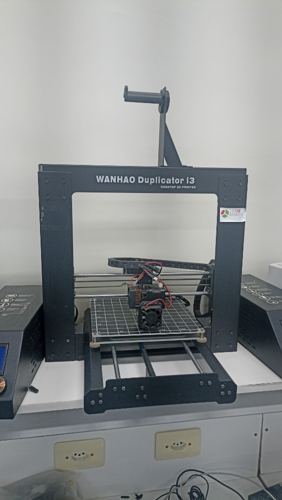

# 4.3 Guia Prático: Wanhao Duplicator i3

A **Wanhao Duplicator i3** é uma impressora estruturada em aço com caixa de controle externa lateral e extrusora **Direct Drive**, muito robusta para peças médias em **PLA**, **PETG** e filamentos flexíveis (**TPU**).

## Especificações Técnicas
* **Volume de impressão:** `200 × 200 × 180 mm`
* **Sistema de extrusão:** *Direct Drive* — **Retração: 1,5 mm** *(nunca use 5 mm ou 6 mm!)*
* **Bico padrão:** `0,4 mm`
* **Mesa:** Aquecida com nivelamento manual nos 4 cantos
* **Transferência de arquivo:** Cartão **microSD** (inserido na lateral da caixa de controle)

## Configuração no UltiMaker Cura
1. Adicione uma impressora em **Wanhao > Wanhao Duplicator i3** (ou *Custom FFF Printer* com `200 × 200 × 180 mm`, G-code flavor `Marlin` e filamento `1,75 mm`).
2. **Atenção crítica:** Ajuste **Retraction Distance** para **`1,5 mm`** (faixa de 1,0 a 2,0 mm) e velocidade para **`35 mm/s`**.

## Passo a Passo na Bancada

1. **Ligue a caixa de controle lateral** (interruptor traseiro) e confira se os cabos da impressora estão bem conectados e livres de obstruções.
2. **Higienize a superfície da mesa** com álcool isopropílico antes de aquecer.
3. **Pré-aqueça pelo visor da caixa lateral:** pressione o botão giratório e vá em **Quick Settings > Preheat PLA** (ou ajuste manualmente em *Extruder* e *Bed* para PETG).
4. **Troque ou verifique o filamento:** pressione a alavanca diretamente no topo do cabeçote (*Direct Drive*) e empurre o filamento até extrudar de maneira uniforme pelo bico.
5. **Nivelamento de mesa:** execute **Quick Settings > Home All**, depois **Disable Stepper**, e faça o teste da folha A4 nos 4 cantos ajustando as porcas recartilhadas embaixo da plataforma.
6. **Imprima o arquivo:** insira o cartão microSD na caixa de controle, vá em **SD Card > Print File** e selecione o seu `.gcode`.
7. **Monitoramento e retirada:** acompanhe toda a primeira camada; ao final, espere a mesa resfriar completamente antes de remover a peça.

---

[⬅️ 4.2 Creality Ender-2 Pro](4.2-creality-ender-2-pro.md) | [🏠 Início](../README.md) | [Próximo: 4.4 FlashForge Finder ➡️](4.4-flashforge-finder.md)
