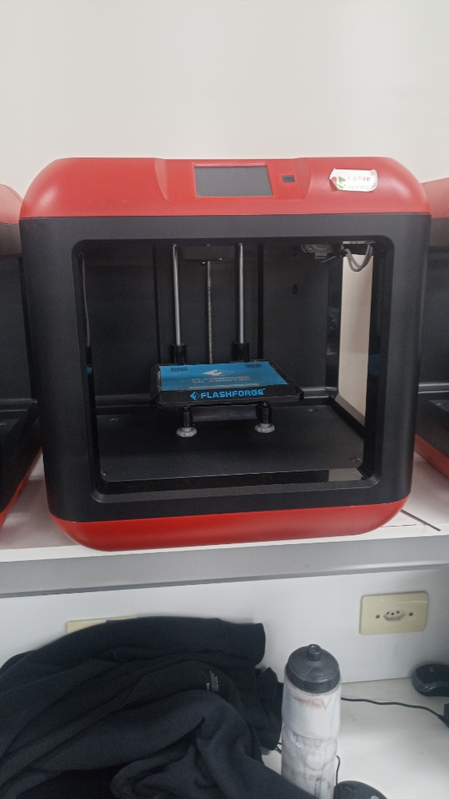

# 4.4 Guia Prático: FlashForge Finder

A **FlashForge Finder** é a máquina mais amigável para primeiras impressões rápidas em **PLA**, equipada com tela sensível ao toque (*touchscreen*), nivelamento assistido por sensor e mesa removível do tipo gaveta.

## Especificações Técnicas e Restrição Importante
* **Volume de impressão:** `140 × 140 × 140 mm`
* **Sistema de extrusão:** *Direct Drive* — **Retração: 1,5 mm**
* **Bico padrão:** `0,4 mm`
* **Mesa Aquecida:** **NÃO POSSUI (Mesa fria com fita azul / adesivo próprio)**
* **Material Permitido:** **EXCLUSIVAMENTE PLA!** *(Não tente imprimir PETG ou ABS nesta máquina, pois sem mesa aquecida a peça vai descolar e pode danificar o hotend).*
* **Transferência de arquivo:** Pendrive **USB** (ou cabo USB / software FlashPrint)

## Atenção ao Fatiar para a FlashForge Finder
* No **UltiMaker Cura**, selecione o perfil da **FlashForge Finder** (ou configure mesa de `140 × 140 × 140 mm` com **Origin at Center** marcado e **Build Plate Temperature = 0 °C**).
* *Observação prática do laboratório:* A FlashForge Finder aceita arquivos `.gx` (gerados pelo fatiador nativo gratuito **FlashPrint**) ou `.g` / `.gcode` compatíveis com o firmware dela. Confirme com o técnico do LabIFMaker se a unidade está operando com `.gcode` do Cura ou `.gx` do FlashPrint antes de gravar no pendrive.

## Passo a Passo na Bancada

1. **Ligue a impressora** no botão traseiro e aguarde a tela *touchscreen* iniciar.
2. **Confira o estado da fita azul na mesa:** se estiver rasgada ou solta, avise o responsável pelo laboratório antes de imprimir. Para melhorar a fixação do PLA em mesa fria, pode-se aplicar uma camada finíssima de cola bastão lavável.
3. **Carregue o filamento PLA:** toque em **Tools > Filament > Load**. A máquina aquece o bico automaticamente até ~210 °C e avisa na tela o momento exato de inserir o fio de PLA pelo topo até sair derretido no bico.
4. **Nivelamento assistido (muito simples!):**
   * Toque em **Tools > Level**.
   * A sonda retrátil mede os 3 pontos da mesa e mostra na tela **para qual lado girar cada parafuso azul** embaixo da mesa até aparecer o sinal de confirmação (`OK`).
5. **Inicie a impressão:** espete o pendrive na entrada USB lateral, toque em **Build**, escolha o ícone do USB, selecione sua peça e toque em **Build**.
6. **Retirada da peça:** ao terminar, destrave e **puxe a mesa como uma gaveta** para fora da máquina — isso facilita muito remover a peça com segurança fora do equipamento.

---

[⬅️ 4.3 Wanhao Duplicator i3](4.3-wanhao-duplicator-i3.md) | [🏠 Início](../README.md) | [Próximo: 4.5 GTMax3D Core H5 ➡️](4.5-gtmax3d-core-h5.md)
