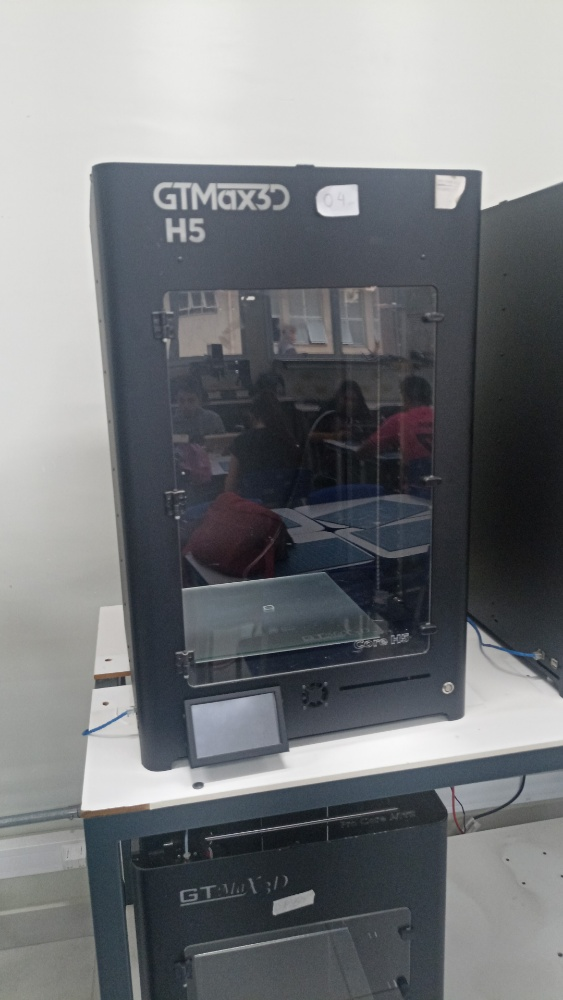

# 4.5 Guia Prático: GTMax3D Core H5 (Bico 0,4 mm vs. Bico 0,8 mm)

A **GTMax3D Core H5** é uma impressora nacional de porte robusto, arquitetura CoreXY de alta estabilidade e **câmara totalmente fechada**. É a máquina ideal para peças grandes, projetos de engenharia/TCC e a **única recomendada no LabIFMaker para impressão de ABS** (além de imprimir **PLA** e **PETG** com excelência).

## ATENÇÃO CRÍTICA: O LabIFMaker possui DUAS GTMax3D Core H5!

Antes de fatiar no UltiMaker Cura, **verifique fisicamente a etiqueta branca no topo frontal da máquina** (como a etiqueta `0.4` visível na foto acima) para não errar o diâmetro do bico!

| Característica | GTMax3D Core H5 — Unidade Bico **0,4 mm** | GTMax3D Core H5 — Unidade Bico **0,8 mm** |
| :--- | :---: | :---: |
| **Identificação** | Etiqueta **`0.4`** no painel frontal | Etiqueta **`0.8`** no painel frontal |
| **Aplicação Ideal** | Peças detalhadas, encaixes precisos, caixas com textos/furos pequenos e protótipos finos. | Peças grandes, suportes estruturais robustos e protótipos rápidos (**imprime até 3x mais rápido!**). |
| **Line Width (Largura de Linha)** | `0,40 mm` | `0,80 mm` |
| **Altura de Camada Padrão** | `0,20 mm` *(faixa: 0,12 a 0,28 mm)* | `0,40 mm` *(faixa: 0,24 a 0,56 mm)* |
| **Número de Paredes (Walls)** | `3 a 4` paredes (`1,2 a 1,6 mm`) | `2 a 3` paredes (`1,6 a 2,4 mm`) |
| **Velocidade Recomendada** | `50 a 60 mm/s` | `35 a 45 mm/s` *(atenção: o bico 0,8 derrete 4x mais plástico por segundo — não exagere na velocidade!)* |
| **Retração (*Direct Drive*)** | `1,5 mm` (35 mm/s) | `1,5 a 2,0 mm` (30 mm/s) |

> **Perigo de errar o bico no Cura:** Se você fatiar um arquivo para bico **0,4 mm** e colocar para imprimir na máquina de bico **0,8 mm** (ou vice-versa), a vazão de plástico ficará completamente descalibrada, causando falhas graves, excesso de material ou entupimento.

## Regra da Porta Fechada vs. Porta Aberta na GTMax3D Core H5

* **Imprimindo ABS:** Mantenha a **porta frontal e a tampa superior FECHADAS** do início ao fim (e ventoinha de peça em `0% a 20%`). Isso retém o calor interno e evita *warping* e rachaduras.
* **Imprimindo PLA (ou PETG em dias muito quentes):** Deixe a **porta frontal entreaberta ou aberta** e a ventoinha de peça ligada (`100%` no PLA; `40%–60%` no PETG) para evitar que o ar quente acumulado dentro da câmara amoleça o filamento antes do bico (*heat creep*).

## Passo a Passo na Bancada

1. **Confira qual das duas unidades está usando (`0.4` ou `0.8`)** e certifique-se de que o seu `.gcode` foi fatiado para o bico correspondente.
2. **Prepare a mesa de vidro:** com a mesa fria, limpe com álcool isopropílico. Para **ABS** ou **PETG**, aplique uma camada fina e uniforme de fixador adequado (spray fixador ou cola bastão conforme orientação do laboratório) — no PETG isso atua inclusive como película protetora para o vidro não lascar na retirada!
3. **Pré-aqueça pelo painel touchscreen** de acordo com o material (**PLA:** 200/60 °C | **PETG:** 235/75 °C | **ABS:** 240/100 °C).
4. **Carregue o filamento** usando a rotina de carregamento do menu e verifique se o plástico sai reto e constante pelo bico.
5. **Confira o nivelamento / *Z-offset*** da primeira camada ao iniciar o arquivo (via cartão SD ou interface de rede/pendrive da máquina).
6. **Acompanhe os 5 minutos iniciais** e verifique se a porta está na posição correta para o material escolhido (fechada para ABS; aberta para PLA).
7. **Resfriamento obrigatório:** ao finalizar, **nunca force a peça quente no vidro** (especialmente em ABS e PETG). Espere a mesa cair abaixo de **40 °C** — você frequentemente ouvirá um pequeno "estalo" indicando que a peça se desprendeu sozinha!

---

[⬅️ 4.4 FlashForge Finder](4.4-flashforge-finder.md) | [🏠 Início](../README.md) | [Próximo: 4.6 Checklist e Segurança ➡️](4.6-checklist-operacao-seguranca.md)
